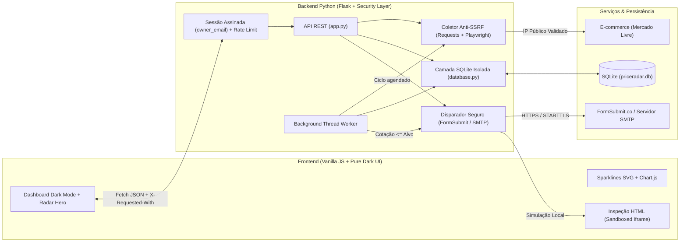

<div align="center">

# PriceRadar

**Sistema Multi-Usuário de Monitoramento de Preços, Série Histórica e Alertas Automatizados via Web Scraping**

[](https://www.python.org/)
[](https://flask.palletsprojects.com/)
[](https://playwright.dev/python/)
[](https://www.crummy.com/software/BeautifulSoup/)
[](https://www.sqlite.org/)
[](#-segurança-e-isolamento-multi-usuário)
[](./DESIGN.md)
[](./LICENSE)

<p align="center">
  Aplicação Full-Stack leve, segura e modular para rastreamento contínuo de preços em e-commerces (com foco no <strong>Mercado Livre</strong>), isolamento por e-mail de usuário, análise visual de série histórica e disparo automático de alertas em HTML.
</p>

[Funcionalidades](#-funcionalidades-principais) •
[Segurança & Multi-Usuário](#-segurança-e-isolamento-multi-usuário) •
[Arquitetura](#-arquitetura-do-sistema) •
[Design System (UI/UX)](#-design-system--uiux) •
[Como Executar](#-como-executar-localmente) •
[Referência da API](#-referência-da-api-rest)

</div>

---

## 📌 Visão Geral

O **PriceRadar** foi projetado para resolver um problema real de consumidores e analistas de e-commerce: acompanhar oscilações de preços sem depender de verificações manuais repetitivas.

O sistema combina um **motor de extração híbrido** (requisições HTTP rápidas + fallback em **Playwright Headless Chrome** para contornar desafios JavaScript anti-bot do Mercado Livre), um **worker assíncrono em segundo plano** (`threading`), **isolamento multi-usuário por sessão de e-mail** e uma **interface de alta precisão em Dark Mode** inspirada em ferramentas financeiras modernas (*Linear, Vercel, Fey*).

---

## ✨ Funcionalidades Principais

- **Extração Inteligente em 3 Camadas + Bypass Anti-Bot (Web Scraping):**
  1. **Schema.org (`application/ld+json`):** Leitura estruturada dos metadados oficiais de oferta.
  2. **Seletores DOM Dedicados (Mercado Livre):** Extração de frações e centavos reais (`.andes-money-amount__fraction` e `.andes-money-amount__cents`), ignorando preços anteriores riscados ou valores de parcelamento.
  3. **Fallback Headless Browser (`Playwright`):** Quando o e-commerce apresenta desafio JavaScript (`rps / CloudFront`), o coletor renderiza o DOM real via Google Chrome Headless com bloqueio de recursos pesados e proteção de rede.
- **Identificação Multi-Usuário Simplificada (Sem Senha):**
  - Cada usuário informa apenas seu e-mail para criar ou acessar sua sessão assinada (`HttpOnly` + `SameSite=Lax`), visualizando e gerenciando exclusivamente seus próprios produtos monitorados (`owner_email`).
- **Disparo Automático de E-mail (1-Passo via Relay + SMTP Opcional):**
  - **Modo Zero-Config (FormSubmit.co Relay):** O usuário apenas informa seu e-mail de destino; no primeiro alerta, confirma o link de ativação recebido na caixa de entrada e passa a receber todos os alertas automaticamente.
  - **SMTP Direto via Variáveis de Ambiente:** Suporte nativo a `smtplib` TLS (`PRICERADAR_SMTP_EMAIL` / `PRICERADAR_SMTP_PASSWORD`) e **Simulação Local** com inspeção de payload HTML em iframe isolado (`sandbox`).
- **Série Histórica e Sparklines Vetoriais:** Armazenamento de cada leitura no SQLite (`price_history`) com sparklines SVG nos cards e gráfico interativo (**Chart.js**) comparando a evolução da cotação contra o preço alvo.

---

## 🛡️ Segurança e Isolamento Multi-Usuário

O projeto foi auditado e blindado contra as principais vulnerabilidades de aplicações web e coletores de dados (OWASP API Security Top 10):

- **Prevenção de BOLA / IDOR (Isolamento por `owner_email`):** Todas as rotas de leitura, edição, verificação e exclusão validam se o produto pertence ao `user_email` autenticado na sessão assinada (`itsdangerous`), retornando `404` para IDs de terceiros.
- **Defesa Anti-SSRF (Server-Side Request Forgery) com Prevenção de DNS Rebinding:**
  - Validação estrita de esquemas (`http` / `https`) e resolução DNS prévia (`socket.getaddrinfo`) bloqueando `localhost`, loopback (`127.0.0.0/8`, `::1`), redes privadas RFC1918 (`10.x`, `172.16-31.x`, `192.168.x`) e endpoints de Cloud Metadata (`169.254.169.254`).
  - Revalidação de cada salto de redirecionamento HTTP (`301/302/307/308`) e interceptação de sub-requisições (`page.route`) dentro do Playwright.
- **Controle de Concorrência e Limite de Recursos (Anti-DoS):**
  - Semáforo (`threading.BoundedSemaphore(2)`) limitando instâncias simultâneas do navegador headless, teto de `3 MB` por resposta HTML (`MAX_HTML_BYTES`) e cota de `10` produtos por usuário.
- **Rate Limiting & Proteção Anti-CSRF:**
  - Limitador de requisições em memória por IP e por usuário nas rotas sensíveis (`/api/scrape-preview`, `/api/products`, `/api/check-all`, `/api/test-email`).
  - Exigência do cabeçalho customizado `X-Requested-With: PriceRadar` em todas as mutações (`POST`, `PUT`, `DELETE`).
- **Sanitização contra XSS e Header Injection:**
  - Escape HTML completo (`html.escape`) de títulos, imagens e URLs extraídas antes de compor templates de e-mail, remoção de `CR/LF` em cabeçalhos e política estrita de `Content-Security-Policy` (CSP).

---

## 🏗️ Arquitetura do Sistema



---

## 🎨 Design System & UI/UX

A interface foi desenvolvida sob princípios de **Minimalismo Técnico e Alta Densidade de Dados** (documentados integralmente em [`DESIGN.md`](./DESIGN.md)):

- **Paleta Exclusiva Dark Mode (Obsidian & Zinc):** Superfícies em carbono profundo (`#09090b`, `#0e0e11`, `#141418`) separadas por divisórias cirúrgicas de `1px` (`rgba(255, 255, 255, 0.07)`).
- **Tipografia Tabular (`JetBrains Mono` + `Inter`):** Todos os preços, variações percentuais, contadores e timestamps utilizam `font-variant-numeric: tabular-nums`, garantindo alinhamento vertical exato nas matrizes de comparação.
- **Sincronização Bidirecional de Inputs:** Os controles de definição de Preço Alvo combinam sliders (`<input type="range">`) e campos numéricos (`<input type="number">`) sincronizados em tempo real.
- **Microinterações de Precisão:** Radar vetorial animado no Hero, fita de cotações em tempo real (Live Price Ticker), spotlight radial sob o cursor e inclinação 3D sutil nos cards.

---

## 📂 Estrutura do Repositório

```text
PriceRadar/
├── app.py                  # Servidor Flask, autenticação por sessão, rate-limit, CSRF e rotas REST
├── scraper.py              # Motor de Web Scraping com proteção Anti-SSRF e fallback Playwright
├── database.py             # Persistência SQLite com isolamento por owner_email
├── mailer.py               # Template HTML sanitizado, relay FormSubmit.co e cliente SMTP TLS
├── requirements.txt        # Dependências do ambiente Python (Flask, BS4, Playwright)
├── rodar.bat               # Script de inicialização rápida para Windows
├── DESIGN.md               # Especificação técnica do Design System e padrões de UI/UX
├── README.md               # Documentação principal do projeto
├── templates/
│   └── index.html          # Estrutura semântica do Dashboard e modais de sessão/inspeção
└── static/
    ├── css/
    │   └── style.css       # Tokens CSS, radar animado, ticker, sparklines e layout responsivo
    └── js/
        └── app.js          # Controlador de estado, sessão multi-usuário, Fetch e Chart.js
```

---

## 🚀 Como Executar Localmente

### Pré-requisitos
- **Python 3.10+** instalado
- **Google Chrome** instalado (utilizado pelo Playwright para páginas com proteção JS)

### Passo a Passo

1. **Clone o repositório:**
   ```bash
   git clone https://github.com/Luskinha01-cyber/PriceRadar.git
   cd PriceRadar
   ```

2. **Crie e ative um ambiente virtual:**
   ```powershell
   # No Windows (PowerShell)
   python -m venv .venv
   .\.venv\Scripts\Activate.ps1

   # No Linux / macOS
   python3 -m venv .venv
   source .venv/bin/activate
   ```

3. **Instale as dependências:**
   ```bash
   pip install -r requirements.txt
   ```

4. **Inicie o servidor:**
   ```bash
   python app.py
   ```
   *(No Windows, você também pode iniciar dando dois cliques no arquivo `rodar.bat`).*

5. **Acesse no navegador:**
   Abra **[http://127.0.0.1:5000](http://127.0.0.1:5000)**, informe seu e-mail para abrir sua sessão e cadastre os produtos desejados.

---

## 🔌 Referência da API REST

Todas as rotas de mutação (`POST`, `PUT`, `DELETE`) exigem o cabeçalho `X-Requested-With: PriceRadar`.

| Método | Rota | Descrição |
| :--- | :--- | :--- |
| `GET` | `/api/state` | Retorna o estado da sessão atual e os produtos pertencentes ao `user_email` conectado. |
| `POST` | `/api/session` | Autentica o e-mail do usuário na sessão assinada (`HttpOnly`) e aplica o intervalo desejado. |
| `POST` | `/api/logout` | Encerra a sessão atual do navegador. |
| `POST` | `/api/scrape-preview` | Extrai título, imagem e preço atual de uma URL pública validada contra SSRF. |
| `POST` | `/api/products` | Cadastra um novo produto vinculado ao `owner_email` da sessão atual. |
| `PUT` | `/api/products/<id>` | Atualiza o Preço Alvo e o e-mail de alerta (restrito ao proprietário do item). |
| `DELETE` | `/api/products/<id>` | Remove o produto e sua série histórica (restrito ao proprietário do item). |
| `POST` | `/api/products/<id>/check` | Executa a coleta via Web Scraping em tempo real para um produto do usuário. |
| `POST` | `/api/products/<id>/simulate-drop` | Simula uma queda promocional abaixo do alvo e dispara o alerta correspondente. |
| `POST` | `/api/check-all` | Sincroniza todos os produtos pertencentes ao usuário conectado. |
| `POST` | `/api/test-email` | Dispara um e-mail de teste para o endereço da sessão atual. |

---

## 📄 Licença

Este projeto está sob a licença **MIT**. Consulte o arquivo [LICENSE](./LICENSE) para mais detalhes.

---

<div align="center">
  Desenvolvido por <a href="https://github.com/Luskinha01-cyber"><strong>Lucas (Luskinha01-cyber)</strong></a>
</div>
