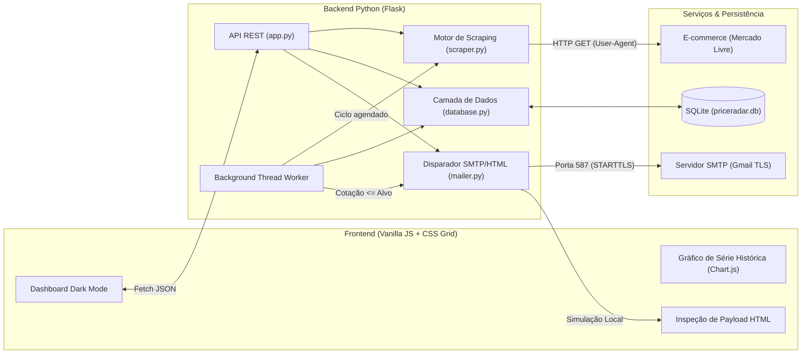

<div align="center">

# PriceRadar

**Sistema de Monitoramento de Preços, Série Histórica e Alertas Automatizados via Web Scraping**

[](https://www.python.org/)
[](https://flask.palletsprojects.com/)
[](https://www.crummy.com/software/BeautifulSoup/)
[](https://www.sqlite.org/)
[](./DESIGN.md)
[](./LICENSE)

<p align="center">
  Aplicação Full-Stack leve e modular para rastreamento contínuo de preços em e-commerces (com foco no <strong>Mercado Livre</strong>), análise visual de série histórica e disparo de alertas em HTML via SMTP.
</p>

[Funcionalidades](#-funcionalidades-principais) •
[Arquitetura](#-arquitetura-do-sistema) •
[Design System (UI/UX)](#-design-system--uiux) •
[Como Executar](#-como-executar-localmente) •
[Referência da API](#-referência-da-api-rest) •
[Roadmap](#-roadmap-de-evolução)

</div>

---

## 📌 Visão Geral

O **PriceRadar** foi projetado para resolver um problema real de consumidores e analistas de e-commerce: acompanhar oscilações de preços sem depender de verificações manuais repetitivas.

O sistema combina um **motor de extração em múltiplas camadas** (JSON-LD Schema.org, seletores DOM específicos do Mercado Livre e metadados OpenGraph) com um **worker assíncrono em segundo plano** (`threading`) e uma **interface de alta precisão em Dark Mode** inspirada em ferramentas financeiras e técnicas modernas (*Linear, Vercel, Fey*).

---

## ✨ Funcionalidades Principais

- **Extração Inteligente em 3 Camadas (Web Scraping):**
  1. **Schema.org (`application/ld+json`):** Leitura estruturada dos metadados oficiais de oferta.
  2. **Seletores DOM Dedicados (Mercado Livre):** Extração de frações e centavos reais (`.andes-money-amount__fraction` e `.andes-money-amount__cents`), ignorando preços anteriores riscados ou valores de parcelamento.
  3. **Fallback OpenGraph (`og:title`, `og:image`, `product:price:amount`):** Compatibilidade estendida para outros portais de e-commerce.
- **Monitoramento Contínuo em Background:** Thread dedicada que verifica periodicamente todos os ativos cadastrados conforme o intervalo configurado pelo usuário.
- **Série Histórica e Análise Gráfica:** Armazenamento de cada leitura no banco SQLite (`price_history`) com visualização interativa em gráfico de linha (**Chart.js**) comparando a evolução da cotação contra o preço alvo definido.
- **Motor de Notificações Híbrido (SMTP Real + Simulação Local):**
  - Disparo real de e-mails transacionais utilizando `smtplib` e `email.mime` com criptografia TLS (compatível com *Senhas de App* do Gmail).
  - **Modo de Simulação Local:** Permite testar, inspecionar e validar o payload HTML do e-mail diretamente na interface sem exigir credenciais SMTP prévias.
- **Simulador de Queda de Preço (1-Click Demo):** Permite forçar uma redução percentual abaixo do gatilho configurado para validar todo o fluxo de alerta, persistência e atualização visual em tempo real.

---

## 🏗️ Arquitetura do Sistema



---

## 🎨 Design System & UI/UX

A interface foi desenvolvida sob princípios de **Minimalismo Técnico e Alta Densidade de Dados** (documentados integralmente em [`DESIGN.md`](./DESIGN.md)):

- **Paleta Exclusiva Dark Mode (Obsidian & Zinc):** Superfícies em carbono profundo (`#09090b`, `#0e0e11`, `#141418`) separadas por divisórias cirúrgicas de `1px` (`rgba(255, 255, 255, 0.07)`).
- **Tipografia Tabular (`JetBrains Mono` + `Inter`):** Todos os preços, variações percentuais, contadores e timestamps utilizam `font-variant-numeric: tabular-nums`, garantindo alinhamento vertical exato nas matrizes de comparação.
- **Sincronização Bidirecional de Inputs:** Os controles de definição de Preço Alvo e intervalo de coleta combinam sliders (`<input type="range">`) e campos numéricos (`<input type="number">`) sincronizados em tempo real.
- **Iconografia Vetorial Limpa:** Uso exclusivo de ícones SVG com traço de `1.75px` e microinterações táteis (`.fx-shine` e `.fx-ripple`).

---

## 📂 Estrutura do Repositório

```text
PriceRadar/
├── app.py                  # Servidor Flask, rotas da API REST e worker em background
├── scraper.py              # Motor de Web Scraping (JSON-LD, DOM Mercado Livre e OpenGraph)
├── database.py             # Persistência SQLite (CRUD de produtos, histórico e parâmetros)
├── mailer.py               # Construtor de template HTML e cliente SMTP TLS / Simulação
├── requirements.txt        # Dependências do ambiente Python
├── rodar.bat               # Script de inicialização rápida para Windows
├── DESIGN.md               # Especificação técnica do Design System e padrões de UI/UX
├── README.md               # Documentação principal do projeto
├── templates/
│   └── index.html          # Estrutura semântica do Dashboard e modais de inspeção
└── static/
    ├── css/
    │   └── style.css       # Tokens CSS, layout responsivo e microanimações
    └── js/
        └── app.js          # Controlador de estado, chamadas Fetch e renderização Chart.js
```

---

## 🚀 Como Executar Localmente

### Pré-requisitos
- **Python 3.10+** instalado
- **Git** (opcional, para clonar o repositório)

### Passo a Passo

1. **Clone o repositório:**
   ```bash
   git clone https://github.com/Luskinha01-cyber/PriceRadar.git
   cd PriceRadar
   ```

2. **Crie e ative um ambiente virtual:**
   ```powershell
   # No Windows (PowerShell)
   python -m venv .venv
   .\.venv\Scripts\Activate.ps1

   # No Linux / macOS
   python3 -m venv .venv
   source .venv/bin/activate
   ```

3. **Instale as dependências:**
   ```bash
   pip install -r requirements.txt
   ```

4. **Inicie o servidor:**
   ```bash
   python app.py
   ```
   *(No Windows, você também pode iniciar dando dois cliques no arquivo `rodar.bat`).*

5. **Acesse no navegador:**
   Abra **[http://127.0.0.1:5000](http://127.0.0.1:5000)**

---

## 🔌 Referência da API REST

| Método | Rota | Descrição |
| :--- | :--- | :--- |
| `GET` | `/api/state` | Retorna todos os produtos monitorados, histórico de preços, KPIs e configurações. |
| `POST` | `/api/scrape-preview` | Extrai título, imagem e preço atual de uma URL antes do cadastro definitivo. |
| `POST` | `/api/products` | Cadastra um novo produto no monitoramento e verifica se já atingiu a meta. |
| `PUT` | `/api/products/<id>` | Atualiza o Preço Alvo (gatilho) e o e-mail de notificação de um produto. |
| `DELETE` | `/api/products/<id>` | Remove o produto e sua série histórica do banco SQLite. |
| `POST` | `/api/products/<id>/check` | Executa a coleta via Web Scraping em tempo real para um produto específico. |
| `POST` | `/api/products/<id>/simulate-drop` | Simula uma queda promocional abaixo do alvo e dispara o alerta correspondente. |
| `POST` | `/api/check-all` | Sincroniza o lote completo de produtos cadastrados. |
| `POST` | `/api/settings` | Atualiza credenciais SMTP e o intervalo do agendador em segundo plano. |
| `POST` | `/api/test-email` | Dispara um e-mail de teste (via SMTP autenticado ou Simulação Local). |

---

## 🛣️ Roadmap de Evolução

- [ ] Suporte a páginas renderizadas dinamicamente via **Playwright / Headless Browser** para lojas com proteção anti-bot avançada.
- [ ] Exportação da série histórica de preços em formato **CSV / Excel**.
- [ ] Integração com **Webhooks (Discord / Telegram)** além do canal de e-mail SMTP.
- [ ] Agrupamento de múltiplos links de varejistas distintos para o mesmo SKU.

---

## 📄 Licença

Este projeto está sob a licença **MIT**. Consulte o arquivo [LICENSE](./LICENSE) para mais detalhes.

---

<div align="center">
  Desenvolvido por <a href="https://github.com/Luskinha01-cyber"><strong>Lucas (Luskinha01-cyber)</strong></a>
</div>
